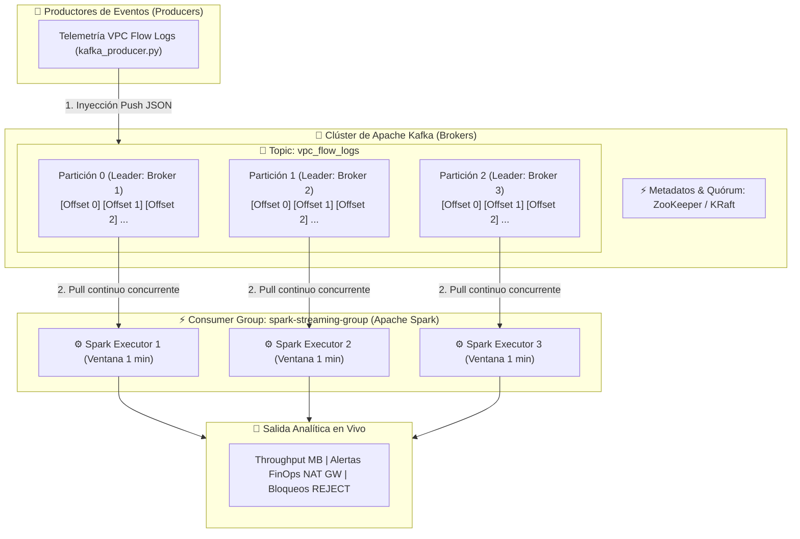

# Aporte Teórico: Fundamentos de Procesamiento Distribuido con Apache Spark y Apache Kafka
**Curso:** Big Data (Código: 202016911A_2204) — Tarea 3  
**Estudiante:** Carlos Mario Mora Restrepo (Cód. 98636340)  
**Grupo:** 27  
**Tutor:** Javier Antonio Ballesteros Ricaurte  
**Universidad Nacional Abierta y a Distancia (UNAD)**  
**Octubre de 2026**

---

## 1. Tabla Comparativa: Apache Hadoop (MapReduce) vs. Apache Spark

| Criterio | Apache Hadoop (MapReduce) | Apache Spark |
| :--- | :--- | :--- |
| **Arquitectura de Procesamiento** | Basada en disco (Disk-centric). El cómputo se divide en dos fases rígidas: `Map` y `Reduce`. Cada fase intermedia persiste obligatoriamente en disco (HDFS o almacenamiento local), incurriendo en overhead de I/O y serialización. | Basada en memoria (In-Memory Processing). Utiliza un Grafo Acíclico Dirigido (DAG) que compone múltiples transformaciones y canaliza etapas (pipelining) en la memoria RAM de los nodos ejecutores, volcando a disco únicamente cuando excede la capacidad (spill to disk). |
| **Rendimiento y Latencia** | Latencia alta (orientado a procesamiento por lotes masivo no interactivo). Rendimiento degradado en algoritmos iterativos debido al constante ciclo de escritura y lectura en disco. | Hasta 100 veces más rápido en memoria y 10 veces más rápido en disco frente a MapReduce. Excelente para computación iterativa, consultas interactivas y pipelines complejos. |
| **Abstracción de Datos** | Pares clave-valor (`<Key, Value>`) de bajo nivel y archivos planos en sistemas de archivos distribuidos (HDFS). | Abstracciones de alto nivel enriquecidas: **RDD** (Resilient Distributed Datasets), **DataFrames** (datos estructurados con esquema) y **Datasets** (tipado estático en JVM). |
| **Tolerancia a Fallos** | Basada en la replicación física de bloques de datos en HDFS (por defecto, factor de replicación de 3) y re-ejecución de tareas de map o reduce fallidas desde disco. | Basada en el **Linaje del DAG (Lineage Graph)**. Si una partición en memoria se pierde por falla de un nodo, se reconstruye determinísticamente ejecutando únicamente las transformaciones que la originaron, sin replicar estados en memoria. |
| **Soporte de Cargas de Trabajo** | Específicamente diseñado para procesamiento por lotes (Batch). Requiere herramientas externas complementarias del ecosistema (ej. Apache Storm o Flink para streaming, Mahout para ML). | Plataforma unificada: Cómputo por lotes (Spark Core), Consultas SQL y estructuradas (Spark SQL), Procesamiento de flujos en tiempo real (Spark Streaming / Structured Streaming), Machine Learning (MLlib) y procesamiento de grafos (GraphX). |
| **Gestión de Recursos y Despliegue** | Primariamente acoplado a YARN (Yet Another Resource Negotiator). | Agnóstico al orquestador: Puede ejecutarse en modo Standalone, sobre Apache Hadoop YARN, Apache Mesos o en orquestadores modernos como Kubernetes. |
| **Casos de Uso Típicos** | Transformaciones ETL masivas por lotes ejecutadas en ventanas de mantenimiento nocturnas (archivos de terabytes/petabytes donde la latencia no es un factor crítico y prima el bajo costo de almacenamiento). | Analítica iterativa de Machine Learning, analítica interactiva de autoservicio (BI / Data Warehousing), pipelines de ingeniería de datos en tiempo real (Fast Data / Streaming) y cálculo de métricas financieras o forenses complejas. |

---

## 2. Resilient Distributed Datasets (RDDs): Conceptos, Propiedades y Operaciones

### 2.1 Definición Conceptual
El **RDD (Resilient Distributed Dataset)** es la abstracción fundamental de Apache Spark. Representa una colección distribuida de elementos tolerante a fallos, particionada a lo largo de los nodos ejecutores de un clúster, sobre la cual se pueden ejecutar operaciones en paralelo.

### 2.2 Propiedades Fundamentales
1. **Inmutabilidad:**
   * Una vez creado, un RDD no puede ser modificado en memoria (read-only).
   * Cualquier transformación (`map`, `filter`) no altera el RDD original, sino que deriva un **nuevo RDD**.
   * *Ventaja arquitectónica:* Garantiza consistencia en entornos concurrentes, elimina problemas de sincronización/bloqueos de memoria y permite la reconstrucción determinística ante fallos.
2. **Particionamiento:**
   * Los datos contenidos en un RDD se dividen lógicamente en fragmentos físicos llamados **particiones**.
   * Cada partición se procesa de forma concurrente por un hilo o núcleo en un nodo ejecutor (*Executor*).
   * El nivel de paralelismo del clúster está directamente acoplado al número de particiones del RDD.
3. **Resiliencia mediante Linaje (Lineage Graph / DAG):**
   * El RDD almacena metadatos sobre cómo fue construido a partir de datasets origen u otros RDDs (su "grafo de linaje"). Si un nodo falla y pierde una partición en RAM, Spark no necesita reiniciar todo el pipeline; simplemente re-ejecuta las transformaciones necesarias para reconstruir esa partición específica.

### 2.3 Tipos de Operaciones y Evaluación Perezosa (Lazy Evaluation)
Las operaciones en Spark se evalúan de forma **perezosa (Lazy Evaluation)**: Spark no computa los datos de inmediato cuando se declara una transformación; en su lugar, registra la operación en el grafo de linaje (DAG). La ejecución física solo se dispara cuando el usuario invoca una **Acción**.

```
[Fuente de Datos] ──► RDD1 ──(Transformación)──► RDD2 ──(Transformación)──► RDD3 ──(ACCIÓN)──► [Resultado / Driver]
                            (Registro en DAG - Sin ejecución)            (Materializa DAG en Jobs/Stages)
```

#### A. Transformaciones (Narrow vs. Wide Dependencies)
* **Dependencias Estrechas (Narrow Dependencies):** Cada partición del RDD padre es utilizada por a lo sumo una partición del RDD hijo. No requieren transferir datos a través de la red (no hay *shuffle*).
  * `map(func)`: Aplica una función a cada elemento del RDD de manera 1 a 1.
  * `filter(func)`: Retorna un nuevo RDD conteniendo únicamente los elementos que satisfacen la condición booleana.
  * `flatMap(func)`: Similar a `map`, pero cada elemento de entrada puede mapearse a 0, 1 o más elementos de salida (aplana listas de listas).
* **Dependencias Anchas (Wide Dependencies):** Múltiples particiones hijas dependen de datos distribuidos en particiones de múltiples padres. Exigen re-distribuir datos por la red entre nodos ejecutores (**Shuffle**), lo que implica costo de I/O y serialización.
  * `groupByKey()`: Agrupa los valores de cada clave en una secuencia iterable `(K, Iterable[V])`. **Riesgo:** Transfiere todos los valores por la red antes de agregarlos, pudiendo provocar `OutOfMemoryError` en datasets desbalanceados.
  * `reduceByKey(func)`: Realiza una pre-agregación local (map-side combine) en cada partición antes de emitir los datos a la red para la reducción global. **Es notablemente más eficiente y óptima que `groupByKey`**.

#### B. Acciones (Materialización del Cómputo)
Son operaciones que obligan a Spark a ejecutar el plan lógico acumulado en el DAG y retornar un valor al programa conductor (*Driver*) o escribir datos en el almacenamiento:
* `collect()`: Retorna todos los elementos del RDD al Driver en forma de lista local en memoria. *(Debe usarse con precaución en Big Data para no desbordar la RAM del Driver)*.
* `count()`: Retorna el número total de registros presentes en el RDD.
* `take(n)`: Retorna un arreglo con los primeros `n` elementos del RDD, optimizando la lectura sin escanear todas las particiones si no es necesario.
* `reduce(func)`: Agrega todos los elementos del RDD utilizando una función asociativa y conmutativa (ej. suma total acumulada).

---

## 3. DataFrames en Apache Spark: Arquitectura y Ventajas sobre RDDs

### 3.1 Concepto de DataFrame
Un **DataFrame** es una abstracción de datos relacional de alto nivel que representa una colección distribuida de registros organizados en columnas con nombre, análogo a una tabla en una base de datos relacional o a un DataFrame en Pandas/R, pero diseñado desde su núcleo para cómputo distribuido a gran escala.

### 3.2 Diferencias y Ventajas Arquitectónicas sobre los RDDs

A diferencia de los RDDs, donde los datos se tratan como objetos opacos de Python o Java (donde el motor desconoce su estructura interna), un DataFrame posee un **Esquema Estricto (Schema)** que describe los nombres y tipos de datos de cada columna. Esto habilita dos componentes revolucionarios en el motor de Spark:

1. **Catalyst Optimizer (Optimizador de Consultas Extensible):**
   * Transforma el código declarativo del usuario en un plan de ejecución físico altamente optimizado.
   * **Pushdown Predicates (Empuje de Predicados):** Filtra los registros en la fuente de almacenamiento (disco, parquet, base de datos) antes de cargarlos en memoria, minimizando el tráfico de red.
   * **Projection Pruning (Poda de Columnas):** Lee únicamente las columnas estrictamente necesarias para el cálculo, descartando el resto del registro.
   * **Reordenamiento de Operaciones:** Reorganiza uniones (*joins*) y filtros para minimizar el volumen intermedio de datos a procesar.

2. **Proyecto Tungsten (Eficiencia de Hardware y Memoria):**
   * **Gestión de Memoria Off-Heap en Formato Binario:** Tungsten gestiona la memoria directamente en bytes compactos fuera del recolector de basura de la JVM (*Off-Heap Memory Management*). Elimina el inmenso overhead de memoria de los objetos Java y erradica las pausas por Garbage Collection (GC pauses).
   * **Generación de Código en Tiempo de Ejecución (Whole-Stage Code Generation):** Compila múltiples operaciones del pipeline de datos en una única función de bytecode en caliente, logrando que el procesamiento opere a la velocidad de la CPU y aproveche registros y memoria caché L1/L2/L3.

3. **Interoperabilidad y Expresividad con Spark SQL:**
   * Permite alternar sin fricción entre sintaxis funcional (Python/Scala) y consultas SQL relacionales estándar (`SELECT`, `GROUP BY`, `JOIN`, funciones de ventana).

---

## 4. Arquitectura y Componentes Clave de Apache Kafka

### 4.1 Diagrama de Arquitectura Conceptual de Apache Kafka



```
┌────────────────────────┐
│  Productores de Datos  │
│  (Producers / Ingest)  │
└───────────┬────────────┘
            │
            │  1. Inyección de Eventos (Push)
            ▼
┌─────────────────────────────────────────────────────────────────────────┐
│                   CLÚSTER DE APACHE KAFKA (BROKERS)                    │
│                                                                         │
│  ┌───────────────────────────────────────────────────────────────────┐  │
│  │ TOPIC: vpc_flow_logs                                              │  │
│  │                                                                   │  │
│  │  [Partición 0] ──► [Offset 0][Offset 1][Offset 2]... [Leader: B1] │  │
│  │  [Partición 1] ──► [Offset 0][Offset 1][Offset 2]... [Leader: B2] │  │
│  │  [Partición 2] ──► [Offset 0][Offset 1][Offset 2]... [Leader: B3] │  │
│  └───────────────────────────────────────────────────────────────────┘  │
│                                                                         │
│  Coordinación y Metadata: Apache ZooKeeper / KRaft (Kafka Raft)         │
└────────────────────────────────────┬────────────────────────────────────┘
                                     │
                                     │  2. Consumo Continuo (Pull)
                                     ▼
┌─────────────────────────────────────────────────────────────────────────┐
│               CONSUMIDORES / GRUPOS DE CONSUMO (CONSUMERS)              │
│                                                                         │
│  ┌───────────────────────────────────────────────────────────────────┐  │
│  │ Consumer Group A: Spark Streaming (Micro-batches en Tiempo Real)   │  │
│  │   • Worker 1 ──► Consume Partición 0                              │  │
│  │   • Worker 2 ──► Consume Partición 1                              │  │
│  │   • Worker 3 ──► Consume Partición 2                              │  │
│  └───────────────────────────────────────────────────────────────────┘  │
└─────────────────────────────────────────────────────────────────────────┘
```

### 4.2 Conceptos Clave de la Arquitectura
* **Topic (Tema):** Es la categoría lógica o canal temático donde se publican y almacenan los flujos de registros. Funciona como un registro de confirmación inmutable y secuencial (*append-only log*).
* **Partitions (Particiones):** Cada topic se divide físicamente en particiones distribuidas entre los brokers del clúster. 
  * Constituyen la **unidad básica de paralelismo y escalabilidad horizontal** de Kafka.
  * Los mensajes dentro de una partición tienen un orden inmutable estricto identificado por un número secuencial monotónico llamado **Offset**.
* **Brokers:** Son los servidores o nodos que componen el clúster de Kafka. Cada broker es responsable de almacenar y servir particiones, garantizando la persistencia en disco y gestionando la replicación (un broker actúa como *Leader* de la partición para lecturas/escrituras, mientras otros actúan como *Followers* para tolerancia a fallos).
* **Producers (Productores):** Aplicaciones o servicios que publican eventos en los topics de Kafka. Deciden a qué partición enviar cada mensaje basándose en una clave (*Key-based hashing*) o mediante balanceo *Round-Robin*.
* **Consumers y Consumer Groups:** Clientes o aplicaciones (como Spark Streaming) que leen eventos desde los topics mediante un modelo *Pull*.
  * **Consumer Group:** Conjunto de consumidores que cooperan para procesar un topic. Cada partición es consumida por exactamente un consumidor dentro del mismo grupo, permitiendo escalar el consumo horizontalmente a la par que crecen las particiones.

---

## 5. Referencias Bibliográficas (Normas APA 7ma Edición)

* Apache Software Foundation. (2024). *Apache Spark documentation: RDD programming guide and Spark SQL*. https://spark.apache.org/docs/latest/
* Apache Software Foundation. (2024). *Apache Kafka documentation: Core concepts and architecture*. https://kafka.apache.org/documentation/
* Gélvez García, N. Y., Díaz, R. P., & Vera, N. E. (2012). Hadoop descripción e instalación en distribuciones Linux. *Revista Entérese: Boletín Científico Universitario*, (20), 45-56.
* Macías, M., & Gómez, M. (2015). *Introducción a Apache Spark: para empezar a programar el big data* (pp. 27-40). Editorial UOC.
* Maldonado, S., & Vásquez, C. (2022). *Analytics y Big Data: Ciencia de los Datos aplicada al mundo de los negocios* (pp. 185-195). RIL editores.
* Montoya Suárez, L., & Gil Restrepo, G. A. (2018). *Actualidad e importancia de la implementación de Big Data utilizando las herramientas Hadoop y Spark*. Repositorio Institucional UNAD.
* Velázquez Esquivel, C. I., Ruiz Ayala, J., García Muñoz, L. H., & García Villareal, L. J. (2017). Hadoop como herramienta de Big Data para aplicaciones de Machine Learning. *Congreso Internacional de Investigación Academia Journals*, 9(3), 1120-1125.
